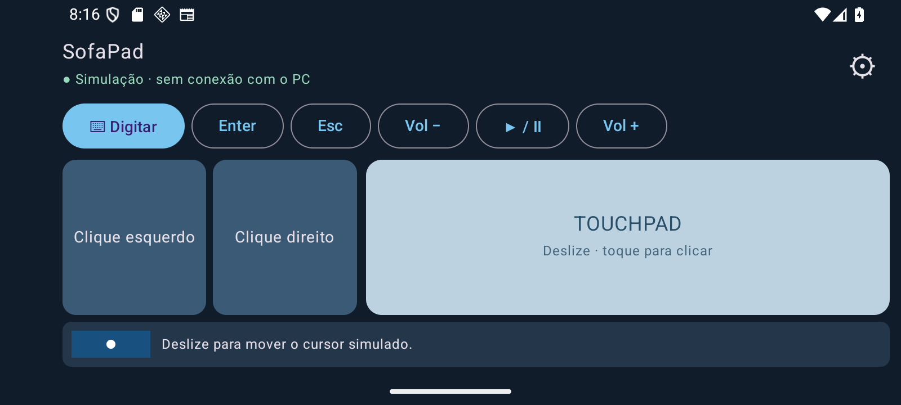
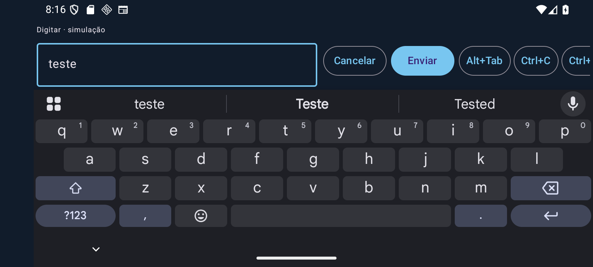

# SofaPad — Couch Remote

Controle remoto de um PC Windows pelo celular Android, na mesma rede Wi-Fi, com touchpad, botões de mouse, digitação e atalhos.

**Estado atual: implementação da Etapa C, em validação.** App Android Kotlin/Compose, controle Windows real via `SendInput`, WSS, pareamento confirmado no PC, credenciais protegidas, revogação, bandeja e opção de início após login. O aceite em celular físico e os testes de reinício/Wi-Fi continuam pendentes. O HTML é apenas referência visual.

Funciona sem contas, nuvem ou transmissão de tela. O agente guarda a identidade e os aparelhos autorizados com Windows DPAPI; o Android protege a autorização com Keystore/AES-GCM. O primeiro pareamento exige conferir a identidade do PC, um código de uso único e a confirmação no Windows.

## Conteúdo

- [Especificação](ESPECIFICACAO.md): requisitos e critérios de aceite da v1.
- [Protótipo visual](prototipo_layout.html): abra o arquivo no navegador para experimentar os layouts e ações simuladas.
- [Plano de conclusão](docs/plano-de-conclusao.md): avaliação inicial, prioridades e verificações por etapa.
- [Build e instalação de desenvolvimento](docs/instalacao.md).
- [Como usar e parear](docs/uso-domestico.md).
- [Segurança e validação da Etapa C](docs/validacao-etapa-c.md).
- [Conectar celular e PC na Etapa B](docs/conexao-etapa-b.md).
- [Testes manuais](docs/testes-manuais.md).
- [Resultados da Etapa A](docs/validacao-etapa-a.md): 29 testes aprovados e limites da entrega.
- [Resultados da implementação da Etapa B](docs/validacao-etapa-b.md): entrada Win32 e interoperabilidade WSS; validação física pendente.
- [Contrato de protocolo](protocol/README.md) e fixtures compartilhadas Kotlin/Rust.
- [Orientações de desenvolvimento](AGENTS.md).
- [Prompt da Etapa A](PROMPT_INICIAL_CODEX.md).
- [Pacote original](LEIA_PRIMEIRO.md).

## Compilar e experimentar

O app abre em Controle: sem PC salvo, mostra simulação; após parear, tenta conectar automaticamente. Digitar usa IME nativo; preferências ficam no DataStore. No Windows, executar o agente sem argumentos abre a bandeja e aguarda aparelhos autorizados. `--simulate` mantém a simulação de loopback para desenvolvimento. O agente não registra texto digitado nem tokens em logs; credenciais em disco são protegidas.

No Windows, com Rust/Build Tools, JDK 17 e Android SDK 36 configurados:

```powershell
.\scripts\build.ps1
```

Os comandos individuais, saídas e instruções para instalar o APK debug estão em [instalação](docs/instalacao.md). O protótipo HTML não faz parte do APK.

## Interface nativa em simulação

Controle horizontal e digitação com teclado Android aberto, capturados durante a Etapa A. A Etapa B mantém esses layouts e acrescenta a conexão nas configurações:





## Regras essenciais

- Horizontal: dois botões lado a lado à esquerda e touchpad à direita; inverter os grupos para canhotos.
- Vertical: touchpad acima e dois botões lado a lado abaixo.
- Digitação pelo teclado Android, envio explícito e sem Enter automático.
- Controle autorizado, transporte criptografado e liberação de teclas e botões em falhas.
- Sem execução remota de shell, elevação de privilégios por padrão ou controle de telas protegidas.

Chaves de assinatura, credenciais de pareamento e artefatos locais não devem ser publicados neste repositório.
